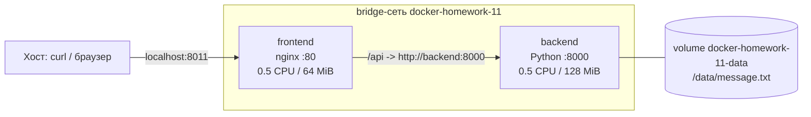

# Отчёт: docker-homework-11

- **Студент:** Насибулин Данила Евгеньевич
- **Вариант N:** 11
- **Персональный идентификатор:** `cd6ac69c`
- **Внешний порт:** 8011 (8000 + 11)
- **Персональная неисправность:** `11 % 4 = 3` — опубликован неправильный внутренний порт frontend

## 1. Схема стенда



На хост публикуется только порт frontend. Backend доступен лишь внутри сети по alias `backend`.

Образы: `docker-homework-11-frontend:11`, `docker-homework-11-backend:11`.

Multi-stage build не используется: ни backend (Python-скрипт на стандартной библиотеке), ни frontend (nginx со статикой и конфигом) ничего не компилируют, поэтому в образ нечего «отделять» от сборочного окружения, а лишняя стадия только усложнила бы Dockerfile.

## 2. Результаты проверок рабочего стенда

### Главная страница и `/api`

```text
$ curl -s -o /dev/null -w 'HTTP %{http_code}\n' http://localhost:8011/
HTTP 200

$ curl -s http://localhost:8011/api
{"name": "Данила", "surname": "Насибулин", "variant": "11", "personal_id": "cd6ac69c",
 "hostname": "e623cf3608ef", "favorite_tool": "systemd",
 "message_from_volume": "Hello from the volume! Edit me and recreate the backend."}
```

Ответ backend содержит имя, фамилию, вариант, идентификатор, hostname контейнера и поле по выбранной теме (`favorite_tool`).

### Сеть

```text
$ docker network inspect docker-homework-11 -f '{{range .Containers}}{{.Name}} {{.IPv4Address}}{{"\n"}}{{end}}'
docker-homework-11-frontend 172.18.0.3/16
docker-homework-11-backend 172.18.0.2/16
```

Оба контейнера в одной пользовательской bridge-сети и общаются по имени (`http://backend:8000`), IP-адреса в конфигурации не используются. Backend не опубликован на хост:

```text
$ docker port docker-homework-11-backend
(пустой вывод)

$ curl -s -m 3 http://localhost:8000/ || echo "недоступен"
недоступен
```

В `docker ps` у backend виден `8000/tcp` без стрелки `->`: это только `EXPOSE` из Dockerfile (метаданные образа), а не публикация на хост. У frontend: `0.0.0.0:8011->80/tcp`.

### Лимиты ресурсов

```text
$ docker inspect -f 'NanoCpus={{.HostConfig.NanoCpus}} Memory={{.HostConfig.Memory}} MemorySwap={{.HostConfig.MemorySwap}}' <контейнер>
backend:  NanoCpus=500000000 Memory=134217728 MemorySwap=134217728
frontend: NanoCpus=500000000 Memory=67108864  MemorySwap=67108864

$ docker stats --no-stream
docker-homework-11-frontend   0.00%   13.96MiB / 64MiB
docker-homework-11-backend    0.01%   29.47MiB / 128MiB
```

Лимит CPU в `docker stats` не отображается, поэтому подтверждён через `docker inspect` (`NanoCpus=500000000` = 0.5 CPU).

### Healthcheck

```text
$ docker inspect -f 'Health={{.State.Health.Status}} Test={{.Config.Healthcheck.Test}}' <контейнер>
backend:  Health=healthy  (python urllib -> http://127.0.0.1:8000/health)
frontend: Health=healthy  (wget -> http://127.0.0.1/)
```

### Volume

```text
$ docker inspect -f '{{range .Mounts}}{{.Type}} {{.Name}} -> {{.Destination}}{{end}}' docker-homework-11-backend
volume docker-homework-11-data -> /data
```

Изменения переживают пересоздание backend. Изменил файл в volume, удалил контейнер и запустил заново:

```text
до пересоздания:    "hostname": "e623cf3608ef", "message_from_volume": "Changed manually, volume survived"
после пересоздания: "hostname": "a0939ac73282", "message_from_volume": "Changed manually, volume survived"
```

Hostname сменился (новый контейнер), а содержимое файла сохранилось.

Скриншот запроса к `/api` через браузер: `screenshot.png`.

## 3. Расследование неисправности (вариант 3: неправильный внутренний порт frontend)

Неисправность внесена после получения рабочего стенда:

```bash
FRONTEND_CONTAINER_PORT=8080 ./scripts/start.sh
```

### Симптом

```text
$ curl -v -m 5 http://localhost:8011/
* Connected to localhost (::1) port 8011
* Recv failure: Connection reset by peer
curl: (56) Recv failure: Connection reset by peer
```

При этом `docker ps -a` показывал оба контейнера `Up (healthy)`, порты frontend: `0.0.0.0:8011->8080/tcp`. Docker считает контейнеры здоровыми, но снаружи сайт не работает.

### Гипотезы

1. Хост-порт 8011 опубликован на порт контейнера, который внутри никто не слушает (nginx слушает другой порт).
2. nginx внутри frontend не запущен или упал.
3. Проблема в backend или в проксировании `/api`.

### Проверочные команды и результаты

```text
$ docker port docker-homework-11-frontend
8080/tcp -> 0.0.0.0:8011

$ docker inspect -f 'Bindings={{json .HostConfig.PortBindings}} Exposed={{json .Config.ExposedPorts}}' docker-homework-11-frontend
Bindings={"8080/tcp":[{"HostIp":"","HostPort":"8011"}]} Exposed={"80/tcp":{},"8080/tcp":{}}

$ docker exec docker-homework-11-frontend netstat -lnt
tcp  0  0 0.0.0.0:80  0.0.0.0:*  LISTEN

$ docker exec docker-homework-11-frontend wget -q -O- http://127.0.0.1:80/ | head -n 3
<!doctype html> ...                       (страница отдаётся)

$ docker exec docker-homework-11-frontend wget -q -O- -T 3 http://127.0.0.1:8080/
wget: can't connect to remote host (127.0.0.1): Connection refused

$ docker logs --tail 10 docker-homework-11-frontend
127.0.0.1 - - [...] "GET / HTTP/1.1" 200 1372 "-" "Wget" "-"     (только запросы healthcheck)
```

- Гипотеза 2 опровергнута: nginx слушает `:80` и отвечает `200`.
- Гипотеза 3 опровергнута: страница `/` отдаётся статикой и backend не использует.
- В логах nginx нет запроса от `curl` с хоста: он не дошёл до nginx и был оборван на уровне публикации порта.

### Подтверждённая причина

Порт 8011 хоста опубликован на порт **8080** контейнера (`-p 8011:8080`), а nginx внутри слушает порт **80**. Docker принимает соединение и пытается переслать его на порт, где никто не слушает, поэтому соединение сбрасывается (`Connection reset by peer`). Состояние `healthy` при этом корректно: healthcheck ходит на `127.0.0.1:80` внутри контейнера и сломанной публикации не видит. Запись `8080/tcp` в `Exposed` появилась автоматически из ключа `-p` и не означает, что порт кто-то слушает.

### Исправление

Стенд перезапущен с правильным внутренним портом (по умолчанию `80`):

```bash
./scripts/start.sh
```

### Повторная исходная проверка

```text
$ docker port docker-homework-11-frontend
80/tcp -> 0.0.0.0:8011

$ curl -s -o /dev/null -w 'HTTP %{http_code}\n' http://localhost:8011/
HTTP 200

$ curl -s http://localhost:8011/api
{"name": "Данила", "surname": "Насибулин", "variant": "11", "personal_id": "cd6ac69c",
 "hostname": "326b6c505c4e", "favorite_tool": "systemd",
 "message_from_volume": "Changed manually, volume survived"}
```

Главная страница и `/api` снова доступны через порт 8011. Данные в volume не пострадали.

## 4. Три самостоятельно принятых решения

1. **nginx резолвит имя backend в момент запроса.** В `nginx.conf` использованы `resolver 127.0.0.11` (встроенный DNS Docker) и `proxy_pass` через переменную. Без этого nginx резолвит имя один раз при старте и не запускается, если backend ещё не поднят или был пересоздан. В моём сценарии backend пересоздаётся отдельно (проверка volume), и frontend продолжает работать без перезапуска.
2. **Backend работает не от root, данные лежат в именованном volume.** В Dockerfile создан пользователь `app` и каталог `/data` с его владельцем. При первом монтировании именованный volume наследует эти права, поэтому backend пишет и читает данные без `chmod 777`. Именованный volume выбран вместо bind mount, чтобы данные не зависели от структуры каталогов хоста и жили независимо от контейнера. Для обоих контейнеров `--memory-swap` равен `--memory`, чтобы лимит памяти был реальным и контейнер не уходил в своп.
3. **Вся конфигурация в одном месте, неисправность вносится параметром.** Номер варианта, порт и идентификатор лежат в `project.env`, откуда `start.sh` передаёт их в контейнеры через переменные окружения, поэтому идентификатор нигде не дублируется. Внутренний порт frontend вынесен в переменную `FRONTEND_CONTAINER_PORT` (по умолчанию 80). Благодаря этому неисправность воспроизводится одной командой без правки файлов и так же легко исправляется.

## 5. Недостаток решения и способ улучшения

**Недостаток:** healthcheck frontend проверяет только `http://127.0.0.1/` внутри контейнера. Как показало расследование, при неверно опубликованном порте контейнер остаётся `healthy`, а сайт снаружи недоступен. Healthcheck также не проверяет цепочку frontend -> backend: если backend упадёт, frontend останется `healthy`, а `/api` перестанет отвечать.

**Как улучшить:** добавить в `start.sh` итоговую проверку «снаружи» (`curl --fail http://localhost:${HOST_PORT}/api`) и завершать скрипт с ошибкой при неудаче. Healthcheck frontend расширить запросом на `/api` через прокси (например, `wget http://127.0.0.1/api`), тогда состояние `healthy` будет отражать работу всей цепочки.